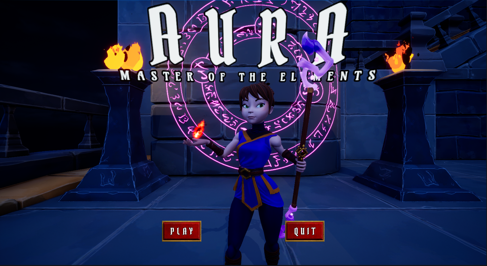

<link rel="preconnect" href="https://fonts.googleapis.com">
<link rel="preconnect" href="https://fonts.gstatic.com" crossorigin>
<link href="https://fonts.googleapis.com/css2?family=Amarante&family=Pirata+One&display=swap" rel="stylesheet">

# Aura
 
### Battle your way through dungeon after dungeon to grow your skills as an elementalist. Face foes ranging from stupid to slightly less than stupid, and do them as much harm as your skills allow.